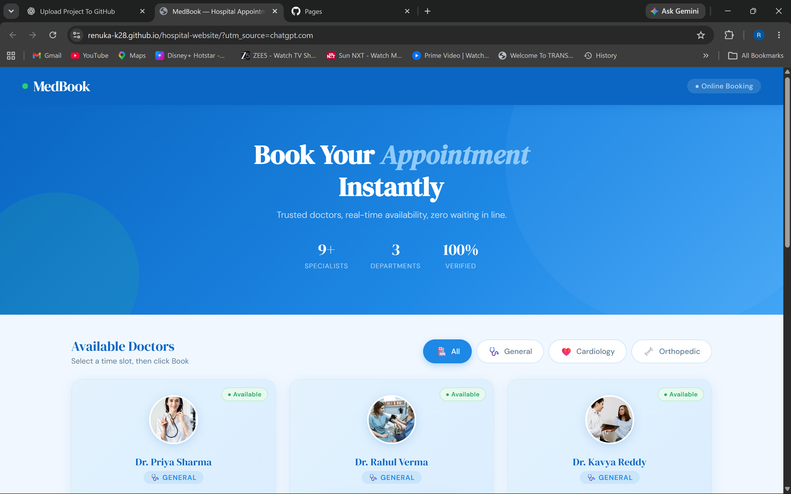
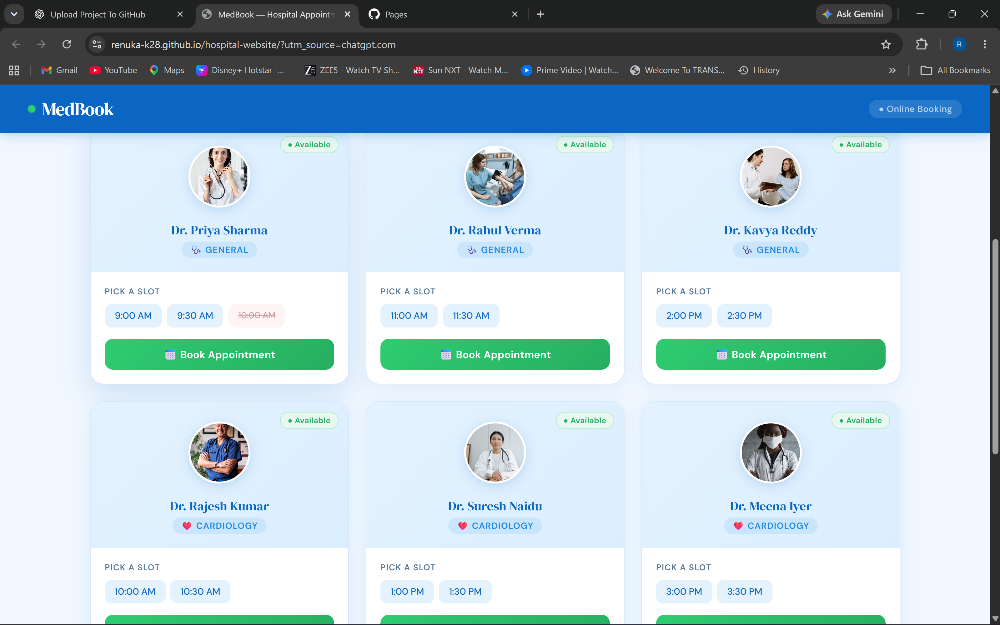
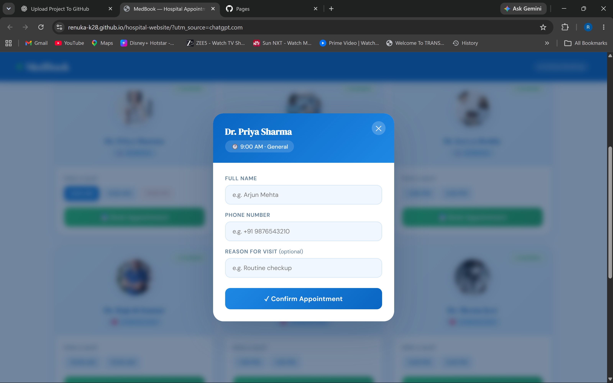

# 🏥 MedBook – Hospital Appointment Booking Website

## 📌 Project Overview

MedBook is a web-based hospital appointment booking interface that helps patients explore doctors, view their specializations, check available appointment slots, and access an online booking form.

## ✨ Features

- Doctor profiles with images and specializations.
- Three departments: General Medicine, Cardiology, and Orthopedics.
- Doctor availability indicators.
- Appointment slot selection.
- Patient appointment booking form.
- Interactive and user-friendly interface.
- Responsive website design.

## 🛠️ Technologies Used

- HTML5
- CSS3
- JavaScript

## 📸 Project Screenshots

### 1. Homepage


### 2. Available Doctors and Appointment Slots


### 3. Appointment Booking Form


## 🌐 Live Demo

[Click here to view MedBook](https://renuka-k28.github.io/hospital-website/)

## 📂 Project Structure

```text
hospital-website/
│
├── index.html
├── homepage.png.png
├── doctors.png.png
├── booking.png.png
└── README.md
```

## 📚 Learning Outcomes

- Practiced HTML, CSS, and JavaScript.
- Developed an interactive website interface.
- Learned GitHub repository management.
- Deployed a website using GitHub Pages.

## 👩‍💻 Author

**Renuka**

GitHub: https://github.com/renuka-k28

